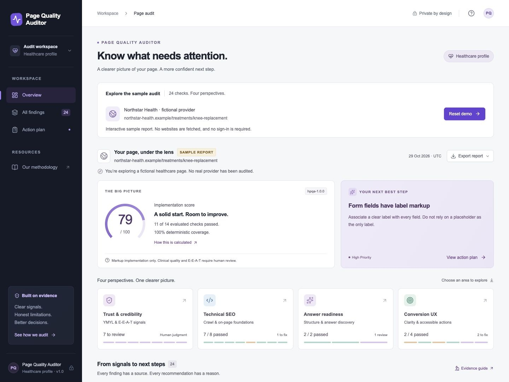
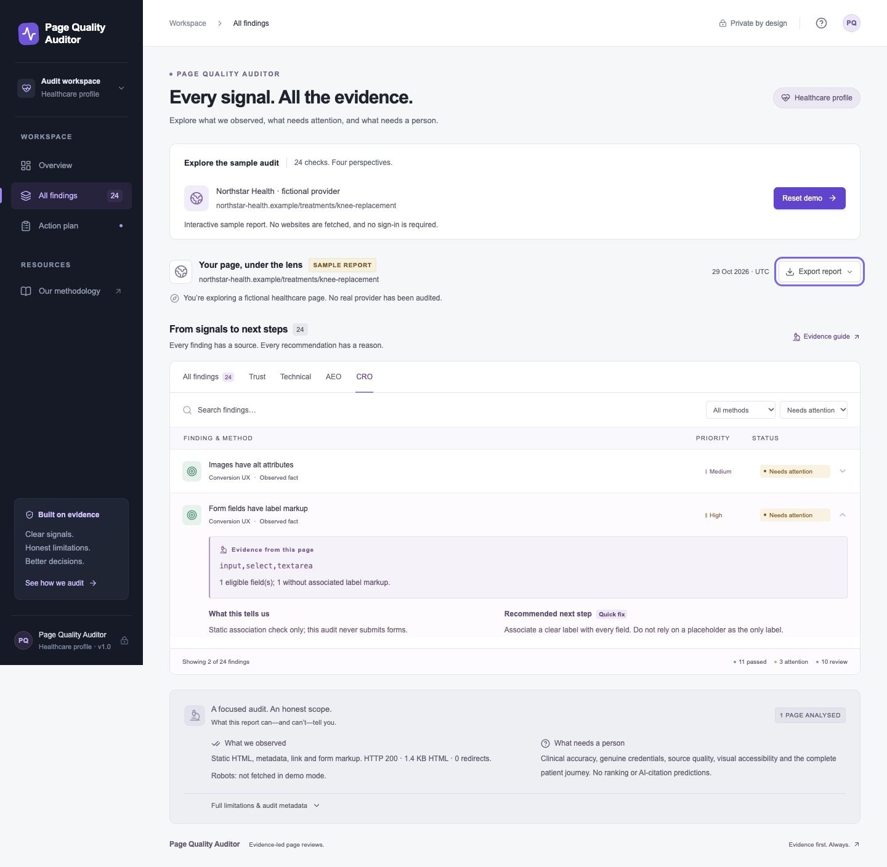
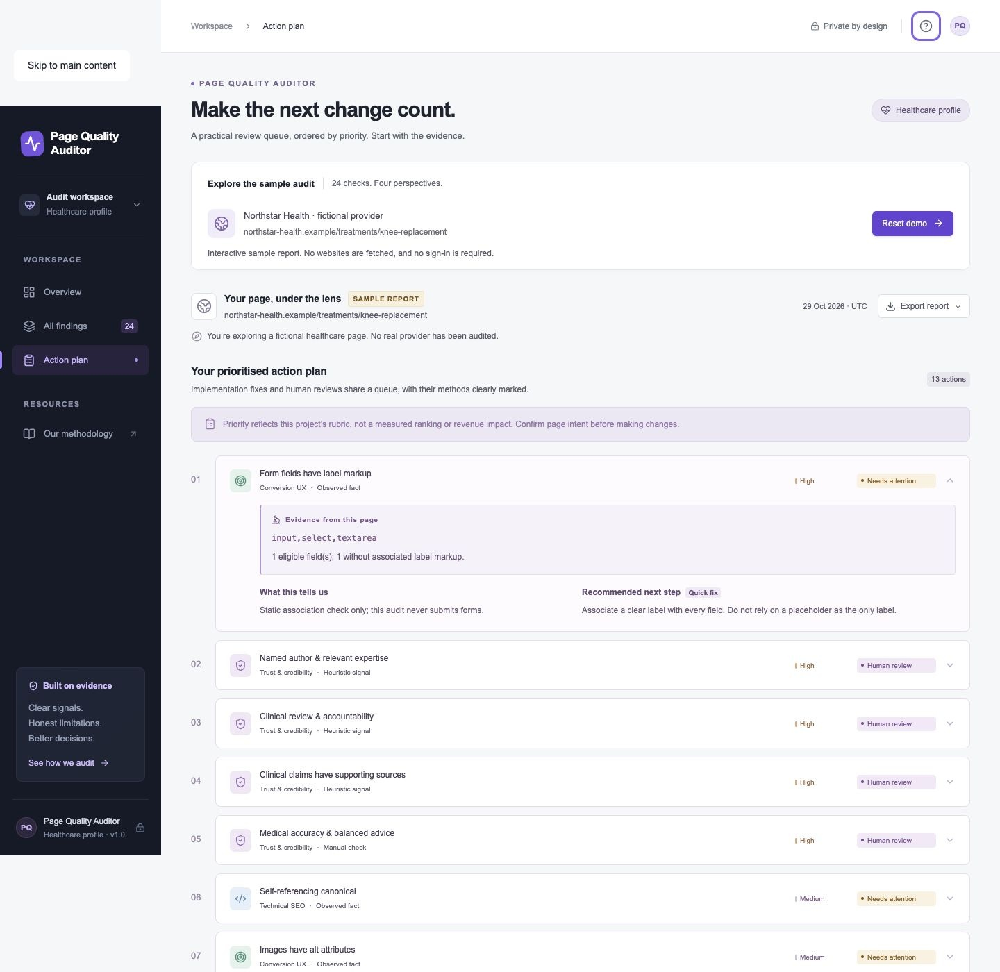
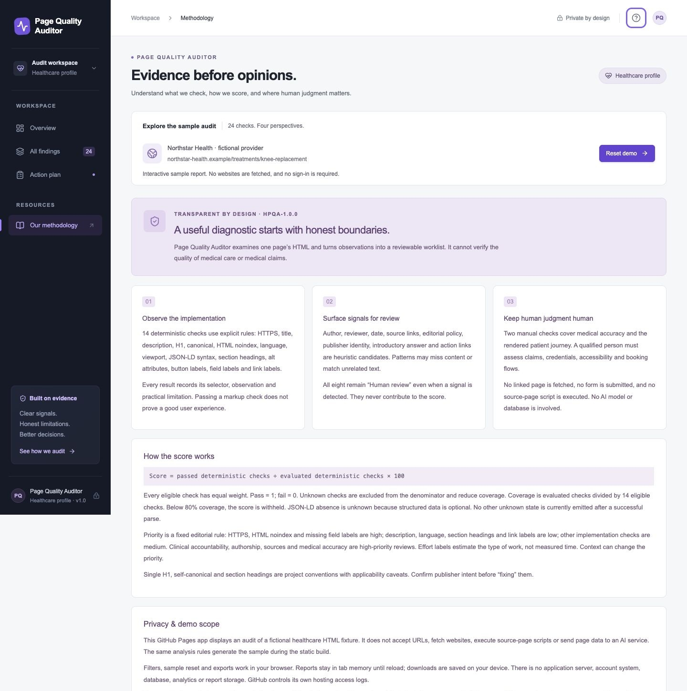
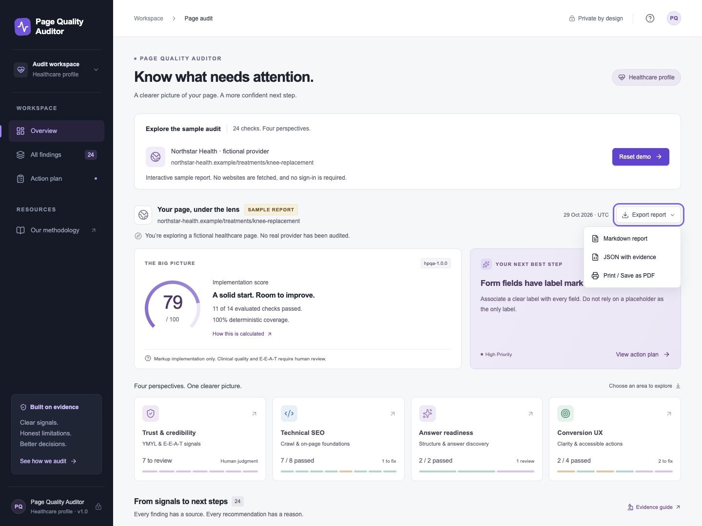

# Page Quality Auditor
**Live demo:** [Explore Page Quality Auditor →](https://madras-forge.github.io/page-quality-auditor/)

An evidence-led audit workspace that turns page-quality signals into a prioritised action plan. It brings **technical SEO, trust and credibility, answer readiness, and conversion UX** into one responsive interface.

The interactive demo uses a fictional healthcare page to explore a central question: **what can an automated check establish, and what still needs human judgment?**

**24 checks · 4 perspectives · Source evidence · Actionable recommendations · Report exports**

[Overview](#desktop-overview) · [Evidence](#findings-and-evidence) · [Action plan](#prioritised-action-plan) · [Methodology](#transparent-methodology) · [Exports](#report-exports) · [Mobile](#mobile-experience)

## The problem

A list of missing tags does not explain whether a healthcare page helps people make informed decisions. At the same time, detecting an author name or a review date cannot establish expertise or medical accuracy.

This project connects implementation checks with editorial review prompts, while making the evidence and limits of each finding visible. The result is a worklist that an SEO manager can discuss with developers, content teams and qualified reviewers.

## The approach

- **Evidence before scores:** every finding includes its source observation, what it means, its limits and a specific next step.
- **Facts and judgments stay distinct:** 14 deterministic checks affect the implementation score; 8 heuristic signals and 2 manual checks remain human-review tasks.
- **Priorities support action:** findings carry an explicit priority and effort label, with a dedicated action-plan view.
- **Detail stays accessible:** the overview supports scanning, while filters and expandable panels reveal the underlying evidence.

## Screenshots

Each screenshot below links to its full-size image and shows the actual application.

### Desktop overview

Implementation score, coverage, four audit perspectives and a clearly labelled fictional report.

### Findings and evidence

Filter by category, method or status; open a finding to inspect its source observation, limitation and recommended fix.

### Prioritised action plan

A review queue separates implementation gaps from the questions that need a person.

### Transparent methodology

Published scoring rules explain what was observed, what is inferred, and what cannot be automated.

### Report exports

Download the complete report as JSON or Markdown, or open the print view. Active filters do not remove findings from exports.

### Mobile experience

Responsive navigation and a stacked report layout keep the same evidence available on smaller screens.

## Technical SEO and product decisions

| Decision                                  | Reason                                                                                    |
| ----------------------------------------- | ----------------------------------------------------------------------------------------- |
| Four audit perspectives                   | Connect search foundations with content accountability, answer structure and user actions |
| Separate facts, signals and manual review | Avoid treating detectable markup as verified trust or clinical quality                    |
| Publish the scoring rubric                | Make the number explainable and reproducible                                              |
| Preserve every finding in exports         | Keep the evidence available when handing work to another team                             |
| Use a fictional healthcare fixture        | Demonstrate realistic gaps without presenting an unreviewed rating of a real provider     |
| Deliver a static application              | Keep the portfolio easy to explore without sign-in or external services                   |

## Built with

**Next.js · React · TypeScript · CSS · Cheerio · Vitest · GitHub Actions**

The analysis module evaluates the HTML fixture during the static build. The React interface handles filtering, evidence disclosures, navigation, sample reset and report downloads in the browser. GitHub Pages serves the exported application.

## Verification

Eight automated analysis/export tests cover fixture findings, scoring, unknown-state handling, labels, title extraction and safe Markdown export. Static-output checks verify repository-path assets, the report structure and all six README screenshots. Browser checks cover filtering, evidence, navigation, reset and JSON downloads.

[Verification details](docs/VALIDATION.md)

## Scope

This is an interactive sample audit with a healthcare profile; live URL scanning is outside this edition. The implementation score describes the project’s markup checks. Clinical accuracy, genuine credentials, accessibility conformance and conversion effectiveness require separate review. The project does not claim measured ranking or business uplift.

## Further reading

[Scoring rubric and check definitions](docs/RUBRIC.md) · [Development and deployment guide](docs/SETUP.md)
